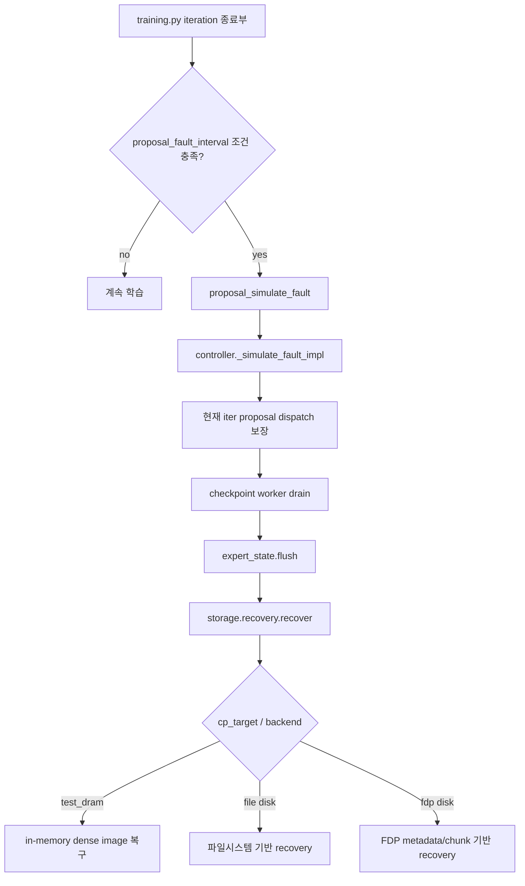
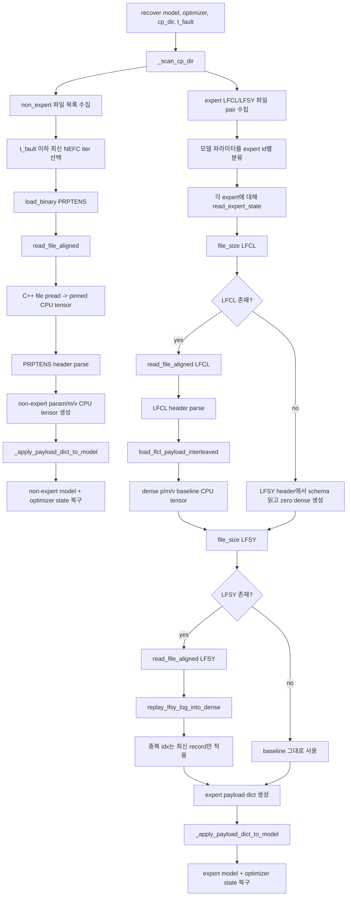

# FDP Recovery Flow 비교

이 문서는 fault 발생 시 proposal checkpoint recovery가 현재 어떤 경로를 타는지와,
FDP raw NVMe backend에 recovery를 붙일 때 어떤 경로로 바뀌어야 하는지를 비교한다.

중요한 현재 상태:

- **파일시스템 기반 recovery는 구현되어 있음.**
- **`cp_target=test_dram` diagnostic recovery도 구현되어 있음.**
- **FDP backend는 write, metadata flush, smoke/debug read까지 구현되어 있음.**
- **FDP metadata를 읽어서 실제 `recover()`에 연결하는 recovery branch가 구현되어 있음.**

즉 아래의 “이전 방식”과 “FDP 방식”은 모두 실행 가능한 경로다. FDP 방식은 파일시스템
scan 대신 raw NVMe/FDP metadata entry를 source of truth로 사용한다.

## 공통 Fault Entry

현재 training 중 synthetic fault는 다음 공통 진입점을 탄다.



실제 코드 기준:

- fault trigger: `megatron/training.py`
- hook: `megatron/proposal/hooks.py`
- controller: `megatron/proposal/controller.py`
- recovery main: `megatron/proposal/storage/recovery.py`

## 이전 방식: 파일시스템 기반 Recovery

파일 방식은 checkpoint object를 일반 파일로 남긴다. Recovery는 디렉터리를 스캔하고,
파일 이름과 파일 크기를 기준으로 읽을 대상을 찾는다.

### 저장되는 파일

```text
cp_dir/
  non_expert/
    fc_nonexpert_iter00000001.bin
    fc_nonexpert_iter00000002.bin
    ...

  expert/
    fc_expert_L00_E00.bin        # LFCL dense baseline
    lossy_expert_L00_E00.bin     # LFSY append log
    fc_expert_L00_E01.bin
    lossy_expert_L00_E01.bin
    ...
```

### Flow Chart



### 파일 방식의 핵심 특성

| 항목 | 동작 |
|---|---|
| object discovery | 디렉터리 scan + 파일명 regex |
| NEFC 선택 | `fc_nonexpert_iter*.bin` 중 `iter <= t_fault` 최신 파일 |
| expert 선택 | `fc_expert_Lxx_Exx.bin`, `lossy_expert_Lxx_Exx.bin` pair |
| 크기 확인 | filesystem `stat` |
| read | C++ `pread` helper로 aligned pinned buffer에 읽음 |
| LFCL 처리 | dense p/m/v baseline으로 load |
| LFSY 처리 | append log replay, 같은 idx는 최신 record 우선 |
| 최종 apply | CPU tensor를 model/optimizer state로 scatter |

## FDP 방식: Metadata/Chunk 기반 Recovery

FDP 방식에서는 파일이 checkpoint object의 source of truth가 아니다.
source of truth는 raw NVMe namespace의 고정 metadata region이다.

현재 FDP metadata는 다음 entry를 가진다.

```text
SuperBlock
MetadataHeader
bitmap
NefcEntry              # 최신 NEFC object
LfcsEntry[expert_slot] # slot별 최신 LFCS/LFCL baseline
LfsyEntry[expert_slot] # slot별 현재 LFSY append log
```

각 entry는 filesystem path 대신 다음 정보를 가진다.

```text
valid
iter / start_iter / generation
logical_bytes 또는 logical_tail
chunk_count
chunks[]
```

### Flow Chart

```mermaid
flowchart TD
    A[recover model, optimizer, t_fault] --> B{backend_kind == fdp?}
    B -- no --> OLD[기존 파일시스템 recovery]
    B -- yes --> C[open_fdp_session_from_env]

    C --> D[metadata image load 또는 현재 세션 metadata 사용]
    D --> E[recovery_entries로 NEFC/LFCS/LFSY entry snapshot]
    E --> F[entry valid/iter/size 검증]
    F --> G[model params classify]

    G --> H[NefcEntry 확인]
    H --> I{NEFC valid?}
    I -- no --> ERR1[복구 불가: NEFC 없음]
    I -- yes --> J{NEFC iter <= fault snapshot?}
    J -- no --> ERR2[복구 대상보다 최신 metadata]
    J -- yes --> K[chunks[] -> raw NVMe read]
    K --> L[PRPTENS blob in pinned CPU tensor]
    L --> M[기존 load_binary parser와 동일한 parse]
    M --> N[non-expert model + optimizer state apply]

    G --> O[expert slot loop]
    O --> P[LfcsEntry slot 확인]
    O --> Q[LfsyEntry slot 확인]
    P --> R{LFCS valid?}
    Q --> S{LFSY valid?}

    R -- yes --> T[LFCS chunks[] -> raw NVMe read]
    T --> U[LFCL header parse]
    U --> V[load_lfcl_payload_interleaved]
    V --> W[dense p/m/v baseline CPU tensor]

    R -- no --> X{LFSY valid?}
    X -- no --> SKIP[해당 slot 복구 데이터 없음]
    X -- yes --> Y[LFSY header에서 schema 읽고 zero dense 생성]

    W --> Z{LFSY valid?}
    Y --> Z
    Z -- yes --> AA[LFSY chunks[] -> raw NVMe read]
    AA --> AB[replay_lfsy_log_into_dense]
    AB --> AC[중복 idx는 최신 record만 적용]
    Z -- no --> AD[baseline 그대로 사용]

    AC --> AE[expert payload dict 생성]
    AD --> AE
    AE --> AF[model + optimizer state apply]
```

### FDP 방식의 핵심 차이

| 항목 | 파일 방식 | FDP 방식 |
|---|---|---|
| object discovery | 디렉터리 scan | metadata image의 entry table |
| object identity | 파일명 | entry index: NEFC 1개, slot별 LFCS/LFSY |
| 위치 정보 | filesystem inode/extent | `chunks[]` + `data_start_lba` + `chunk_bytes` |
| 크기 정보 | `stat(path).st_size` | `logical_bytes`, `logical_tail` |
| read API | `read_file_aligned(path, nbytes)` | `read_fdp_object(entry, offset, nbytes)` |
| NEFC history | 파일 여러 개 중 최신 선택 | 현재 metadata는 최신 1개만 보유 |
| expert history | slot별 LFCL 파일 + LFSY 파일 | slot별 최신 `LfcsEntry` + 현재 `LfsyEntry` |
| parser/replay | PRPTENS/LFCL/LFSY parser 사용 | 동일 parser/replay 재사용 가능 |
| filesystem 의존 | 있음 | 없음 |

## 재사용해야 하는 부분

FDP recovery는 아래 로직을 그대로 재사용한다.

```text
PRPTENS header parse
LFCL header parse
load_lfcl_payload_interleaved
replay_lfsy_log_into_dense
_apply_payload_dict_to_model
```

바뀌어야 하는 부분은 “어디서 bytes를 읽어오느냐”다.

```text
이전:
  path -> stat -> pread -> blob

FDP:
  metadata entry -> chunk list -> raw NVMe read -> blob
```

## FDP Recovery 구현 API 정리

smoke/debug 목적 함수는 offset 기반 byte probe를 제공한다.

```python
fdp_debug_read_nefc(offset, nbytes)
fdp_debug_read_lfcs(layer, expert, offset, nbytes)
fdp_debug_read_lfsy(layer, expert, offset, nbytes)
```

production recovery에서는 metadata snapshot과 object 단위 blob read API를 사용한다.

```python
fdp_recovery_entries() -> NEFC/LFCS/LFSY logical size, iter, generation, valid
fdp_read_nefc_blob() -> torch.uint8 CPU blob
fdp_read_lfcs_blob(layer, expert) -> torch.uint8 CPU blob
fdp_read_lfsy_blob(layer, expert) -> torch.uint8 CPU blob
```

`recover()`는 다음 분기를 탄다.

```python
if backend_kind() == "fdp":
    return _recover_from_fdp(...)
else:
    return filesystem_recovery(...)
```

## `t_fault` 의미 차이

파일 방식은 파일이 여러 개 남아 있으면 과거 `t_fault`로 되돌아가는 선택이 가능하다.

```text
fc_nonexpert_iter00000010.bin
fc_nonexpert_iter00000020.bin
fc_nonexpert_iter00000030.bin

t_fault = 25 -> iter 20 파일 선택 가능
```

반면 현재 FDP metadata 설계는 기본적으로 최신 durable snapshot만 가리킨다.

```text
NefcEntry      -> 최신 NEFC 1개
LfcsEntry[slot] -> slot별 최신 LFCS 1개
LfsyEntry[slot] -> slot별 현재 LFSY log 1개
```

따라서 FDP recovery의 기본 목표는 “임의 과거 iteration 복구”가 아니라
**fault 시점의 최신 durable snapshot 복구**다. 과거 `t_fault` 선택까지 지원하려면
metadata에 object history 또는 checkpoint generation 목록을 추가로 보존해야 한다.

## 최종 요약

```text
파일 방식:
  파일 이름/파일 크기/파일 내용이 source of truth.
  recover()가 이미 구현되어 있음.

FDP 방식:
  raw NVMe metadata entry와 chunk list가 source of truth.
  parser/replay/apply는 기존 로직을 재사용함.
  파일 scan/stat/read 부분은 metadata/chunk raw read로 교체됨.
  recover()는 PROPOSAL_IO_BACKEND=fdp일 때 _recover_from_fdp로 진입함.
```
